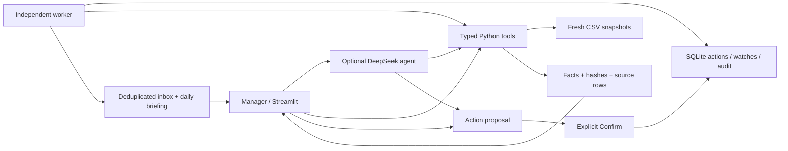

# Architecture and Track 1 coverage

Source requirements: Track 1 on pages 2–4 of `Capstone_Project_Tracks_v3.pdf`, and the project/evaluation requirements in `Capstone_Project_Spec_v4.pdf`. These are design requirements, not authority to email, publish or submit anything.

## Responsibilities

`app.py` is the entry point. `order_risk.py` retains original risk calculations. `factory.py` implements read tools and captures exact rows with CSV line numbers and SHA256. `agent.py` owns a bounded tool loop and rejects missing evidence IDs and literal numeric claims absent from cited facts. Literal-number matching does not prove semantic entailment; human/live evaluation is still needed. Prior chat is context only; every turn reads fresh data.

`deepseek_client.py` uses a fixed official endpoint and never puts the key in prompts/errors. Explicit local opt-in gates requests, with an environment override. The user has now authorized data-bearing API access and chat is enabled. A live retrieval smoke test passed; the full model evaluation remains outstanding. Disabling network access restores deterministic briefing fallback.

`state.py` owns SQLite transactions, idempotent confirmation and the simulation clock. No model-exposed commit tool exists. `scheduler.py` computes checks and briefings; `worker.py` runs separately with an OS-held singleton lock. Watches survive restarts, fire once and notify only at the agreed deadline. Missing source data produces a data-gap alert, not an invented operational claim.

## Coverage

| Requirement | Behavior | Validation / limit |
|---|---|---|
| Five tool kinds | Eight documented tools, narrow schemas | Unit and offline contract tests |
| Scheduled briefing | Confirmed daily schedule, once-per-date persisted facts/prose | Worker tests; deterministic prose currently |
| Multi-turn Q&A | DeepSeek tool loop, fresh reads, bounded history, evidence | Mocked protocol only; real behavior unmeasured |
| Watches | Order movement, stage output, reminders, deduplication | Time-injected tests, worker heartbeat |
| Feasibility | Internal load/rates and all workshop candidates | Independent reference arithmetic; estimates only |
| Actions | Notes, drafts, reminders, schedules, watches/cancellation | Transaction tests; no external sends |
| Traceability | Source hashes, row numbers, downloads, fact tables | Exact-order trace and fresh-read tests |
| UX | Sidebar workflow, concise answers, expandable details | Streamlit AppTest and browser review |
| Evaluation | 33 questions with verified expected answers | 27 tool checks; 6 language-only cases pending |

## Limits

- Snapshot CSVs are not an ERP feed. The clock advances, files do not. Missing production days are explicit.
- Internal feasibility assumes serial stages and full remaining quantities at current/downstream stages. Parallel production may finish sooner; per-order completed pieces are unavailable.
- Workshops are assumed to handle the full batch. The fraction reworked after defects is unknown, so defect probability is not converted into invented retry days. Monetary units are unspecified.
- Output monitoring is heuristic, not seasonal/causal analysis. Local single-user trust model; no external push or automatic startup on reboot. After restart, due checks catch up once.
- Chat/evidence are session-local. Confirmed actions, watches, alerts and scheduled briefings are durable. CSV/notes are always data, including instruction-like text.

## Remaining course deliverables

This iteration does not complete the final submission package. Still needed: authorized real-model evaluation, held-out results, human semantic review and ten analysed real failures; group/member/contribution information; demo/presentation video and slides; public repository/demo if requested; market-researched strategic recommendations; the named PDF/ZIP package. No group details, URLs, measurements or observed failures have been invented.

## References

- The supplied course PDFs define capabilities and evaluation.
- [DeepSeek API introduction](https://api-docs.deepseek.com/) establishes the endpoint and model name.
- [Tool calls](https://api-docs.deepseek.com/guides/tool_calls/) informs the request/result loop.
- [Thinking mode](https://api-docs.deepseek.com/guides/thinking_mode/) documents the disabled-thinking parameter.
- [JSON output](https://api-docs.deepseek.com/guides/json_mode/) informs the structured response format.
